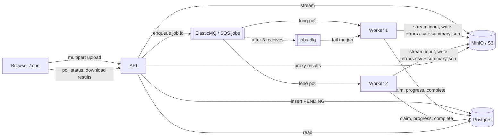

# Async File Processor

A Go service for processing CSV uploads asynchronously. Files are streamed into object storage,
queued, validated row by row by a pool of workers, and turned into a summary report and a
downloadable error file. Nothing is ever held in memory as a whole file, so a multi-hundred-megabyte
upload costs the same as a small one.

The whole system runs locally with Docker Compose. Object storage (MinIO), the queue (ElasticMQ,
which speaks the SQS API) and Postgres stand in for S3, SQS and a managed database. The Go code uses the AWS SDK
against standard S3 and SQS APIs, so only endpoints and credentials would change in a cloud deployment.

## Architecture



1. `POST /api/jobs` streams the multipart file straight into S3 (multipart upload), records a `PENDING`
   job and enqueues its id. It returns `202` immediately.
2. A worker long-polls the queue, claims the job (`PROCESSING`), streams the CSV out of S3, validates every row,
   and streams the invalid rows into `errors.csv` while the file is being read.
3. The worker stores `summary.json`, marks the job `COMPLETED` and deletes the message.
4. Clients poll `GET /api/jobs/{id}` and download the summary and errors file.

## Quickstart

Requires Docker with Compose and Make. Go 1.26 is only needed to run the tests or the sample generator.

```sh
git clone <this repository> && cd <repository>
make up                       # builds the images, starts Postgres, MinIO, ElasticMQ, the API and 2 workers
open http://localhost:8080    # or: curl -F file=@scripts/sample.csv http://localhost:8080/api/jobs
```

The first `make up` compiles the Go services inside Docker and takes a few minutes; later runs use the
build cache. `make up` returns once every container reports healthy.

```sh
make down          # stop the stack, keep the data
make clean         # stop the stack and delete all data (docker compose down -v)
make down ARGS=-v  # same as make clean
```

Only the API is published, and only on `127.0.0.1:8080`. Postgres, MinIO and ElasticMQ are reachable
only from inside the Compose network. Credentials in `.env.example` are for local use only. See
[SECURITY.md](SECURITY.md) for the threat model and the safeguards.

## Demo walkthrough

1. Open http://localhost:8080 and click **Generate sample**. It downloads a 200-row CSV in which one row in ten is
   invalid, covering every validation rule.
2. Drop the file on the page. It appears in the jobs table as `PENDING`, then `PROCESSING` with row progress,
   then `COMPLETED`.
3. Click **Summary** to see totals, rows/sec, and errors grouped by field and by rule.
4. Download `errors.csv` from the Links column: one line per failed rule, with the original row shown once
   on the first line of each row.
5. Upload a file with the wrong header (for example `a,b,c`) to see a permanent failure: the job is
   `FAILED` after one attempt with an explanatory message.
6. Watch `docker compose logs -f worker` while uploading several files: both worker replicas pick up jobs.

## Design decisions

- **Streaming end to end.** The upload handler never parses the form into memory: it reads the multipart
  stream and hands the file part to the S3 uploader, which sends fixed-size parts. The worker reads the object
  as a stream, validates it with `encoding/csv` one record at a time, and pipes the invalid rows into a second
  multipart upload. Memory depends on the number of distinct ids (duplicate detection), not on file size.
- **Bounded worker pool.** Each worker runs `WORKER_CONCURRENCY` goroutines and only asks the queue for as many
  messages as it has free slots. Work therefore never waits in memory while its visibility timeout runs, and
  scaling out is just starting more replicas (Compose runs two).
- **At-least-once delivery, idempotent jobs.** SQS may deliver a message twice, so processing is safe to repeat:
  claiming a job atomically moves it to `PROCESSING`, resets its counters and output keys, and a re-run
  overwrites the same S3 objects. A message for a finished or unknown job is discarded.
- **Retries with backoff.** Permanent problems (empty file, wrong header) fail the job after one attempt.
  Transient errors leave the message on the queue with an exponentially increasing visibility timeout
  (10s, 20s, ... capped at 5 minutes).
- **Heartbeat.** While a file is processed the worker extends the message's visibility every 20 seconds, so a
  large file is not redelivered to a second worker. If a worker dies, the message reappears after the 60s
  visibility timeout and another worker takes over.
- **Dead-letter queue.** After `MAX_ATTEMPTS` (3) the queue's redrive policy moves the message to `jobs-dlq`.
  The workers consume that queue and mark any job still active as `FAILED`, so a worker killed on its final
  attempt cannot leave a job `PROCESSING` forever.
- **Graceful shutdown.** On SIGTERM a worker stops receiving, finishes running jobs for up to
  `SHUTDOWN_TIMEOUT`, and releases messages it had not started. Compose gives workers a 45s grace period
  (20s long poll plus the shutdown timeout).
- **Postgres as the source of truth.** Job state, counters and attempts live in one table; the queue only
  carries job ids. Migrations are embedded in the API binary and applied when it starts, which is why the workers
  wait for a healthy API.
- **Tradeoffs.** Duplicate-id detection keeps every id in memory, so memory grows with unique ids. Results are
  proxied through the API instead of being served with presigned URLs, which keeps object storage private at the
  cost of API bandwidth. Progress is polled, not pushed. ElasticMQ is single-node and in-memory, so queued
  messages do not survive an ElasticMQ restart (job rows do; a lost message leaves a `PENDING` job).

## Public-demo safeguards

The stack is designed to be exposed to the internet from a single machine. [SECURITY.md](SECURITY.md) has the
threat model and the full list; the settings are summarised here.

| Safeguard | Behaviour | Settings |
| --- | --- | --- |
| Upload size limit | Larger uploads are cut off and answered with `413`. | `DEMO_MAX_UPLOAD_BYTES` (compose, default 50 MB), `MAX_UPLOAD_BYTES` (binary, default 500 MB) |
| Rate limit | Token bucket per client on `POST /api/jobs`; `429` with `Retry-After` when empty. Idle clients are evicted from memory; when the table is full, new clients share one overflow bucket. | `UPLOAD_RATE_PER_MIN` (default 10; `0` disables), `UPLOAD_RATE_BURST` (default 5) |
| Client identity | The connection's remote address, or `CF-Connecting-IP` only when trusted (see below). IPv6 clients are keyed by their /64 prefix. | `TRUST_CF_CONNECTING_IP` (default `false`) |
| Upload deadlines | An upload that sends no data for the idle timeout is cut off with `408`; an upload may not run longer than the maximum duration. | `UPLOAD_IDLE_TIMEOUT` (default `30s`), `UPLOAD_MAX_DURATION` (default `10m`); `0` disables |
| Upload concurrency | At most this many uploads stream at once; more get `503` with `Retry-After`. | `MAX_CONCURRENT_UPLOADS` (default 16; `0` disables) |
| Queue caps | Unfinished (`PENDING` or `PROCESSING`) jobs are capped overall (`503`) and per client (`429`), both with `Retry-After`, so one visitor cannot occupy every worker. Counting and inserting are separate statements, so the caps are approximate under concurrency. | `MAX_UNFINISHED_JOBS` (default 50), `MAX_UNFINISHED_PER_CLIENT` (default 3); `0` disables each |
| Error file cap | `errors.csv` holds at most this many error lines per job; counts in the summary stay exact. | `MAX_ERROR_LINES` (worker, default 50000) |
| Record size cap | A CSV record larger than this fails the job (non-retryable). | `MAX_RECORD_BYTES` (worker, default 1048576) |
| Retention | Workers delete finished jobs and their S3 objects older than the retention period, so the disk cannot fill and the job list stays short. | `RETENTION` (default `24h`; `0` disables), `RETENTION_INTERVAL` (default `10m`) |
| Per-browser job list | `GET /api/jobs` returns only the jobs uploaded from the same browser (an `owner` cookie). | `COOKIE_SECURE` (default `false`; set `true` behind HTTPS) |
| Security headers | A strict `Content-Security-Policy`, `X-Content-Type-Options: nosniff`, `X-Frame-Options: DENY`, `Referrer-Policy: no-referrer`, `Permissions-Policy`, `Cross-Origin-Opener-Policy` and `Cross-Origin-Resource-Policy`; `Cache-Control: no-store` on every `/api/` response. | |
| Metrics | Served on a separate internal listener, not on the public API port. | `API_METRICS_ADDR` (default `:9090`, not published) |
| Container limits | Memory, CPU and process limits on every container; the API and workers run with a read-only root filesystem, all capabilities dropped and `no-new-privileges`. | `docker-compose.yml` |
| Network exposure | Only the API is published, on loopback. | `docker-compose.yml` |

The rate limiter and the job caps identify a client by the connection's remote address. `CF-Connecting-IP` is
used only when `TRUST_CF_CONNECTING_IP=true`, which is correct only when the API is reachable solely through
Cloudflare (for example a Cloudflare Tunnel to the loopback port): otherwise any client could forge the header
and dodge every per-client limit. `X-Forwarded-For` is always ignored. The client key is stored on jobs only as
a SHA-256 hash.

The `owner` cookie holds 32 random bytes; only its SHA-256 hash is stored in the database. It is `HttpOnly`,
`SameSite=Lax`, lasts 30 days and is `Secure` when `COOKIE_SECURE=true`. Enable that when the site is served over
HTTPS (for example through the tunnel). Job ids are unguessable UUIDs and act as capability links: anyone who holds
a job's id can open its status, report and `errors.csv`, but the list shows a browser only its own jobs.

The retention sweep runs in every worker; it only touches `COMPLETED` and `FAILED` jobs, deletes objects before the
row, and is idempotent, so concurrent replicas and interrupted sweeps are harmless.

## API

Errors are JSON: `{"error":"message"}`, including unknown paths (`404`) and wrong methods (`405`). Every response
carries an `X-Request-ID` header (a client-supplied value is echoed if it is short and alphanumeric).

| Method and path | Description |
| --- | --- |
| `POST /api/jobs` | Upload a CSV (multipart field `file`). `202` with the new job; the first upload from a browser also sets the `owner` cookie. `400` not a `.csv`, filename invalid or longer than 255 characters, missing `file` field, malformed or incomplete body; `408` the upload stalled or ran too long; `413` over the size limit; `429` rate limited or too many of your jobs in progress; `503` too many uploads in progress or the processing queue is full. `429` and `503` carry `Retry-After`. |
| `GET /api/jobs/{id}` | One job. `404` unknown id, `400` malformed id. The id is a capability link: no cookie is needed. |
| `GET /api/jobs?limit=50` | The jobs uploaded from this browser (matched by the `owner` cookie), newest first; `[]` without a valid cookie. `limit` defaults to 50, capped at 200. |
| `GET /api/jobs/{id}/report` | The job's `summary.json`. `409` until the job is `COMPLETED`. Open to anyone holding the id. |
| `GET /api/jobs/{id}/errors.csv` | The errors file as an attachment named `<uploaded name>-errors.csv`. `409` until `COMPLETED`. Open to anyone holding the id. |
| `GET /api/sample.csv` | A generated 200-row sample with deliberate errors. |
| `GET /healthz`, `GET /readyz` | Liveness and readiness (see Observability). `/metrics` is not served on this port. |

```sh
curl -F file=@scripts/sample.csv http://localhost:8080/api/jobs
curl http://localhost:8080/api/jobs/<id>
curl http://localhost:8080/api/jobs/<id>/report
curl -OJ http://localhost:8080/api/jobs/<id>/errors.csv
```

A job has the fields `id`, `filename`, `status` (`PENDING`, `PROCESSING`, `COMPLETED`, `FAILED`), `total_rows`,
`valid_rows`, `invalid_rows`, `attempts`, `error_msg`, `created_at`, `updated_at`, `started_at` and `finished_at`.
All `/api/` responses are sent with `Cache-Control: no-store`.

## Web UI

The page at http://localhost:8080 is embedded in the API binary (plain HTML, CSS and JavaScript, no build step,
no inline scripts so the strict CSP applies).

- **Upload** - drag CSV files onto the drop zone or click it to choose them. Upload progress is shown per file;
  non-`.csv` files are rejected and server errors (including `413` and `429`) are displayed.
- **Generate sample** - downloads the sample CSV.
- **Jobs table** - refreshes every 2 seconds (paused while the tab is hidden) with status, row progress,
  attempts and duration. Completed jobs link to a **Summary** panel and to the `errors.csv` download. The table
  shows only the jobs uploaded from this browser; the page reminds visitors not to upload real or personal data.
  When a job's `errors.csv` was capped, the Summary panel says so.

## Worker

The worker is the queue consumer. It long-polls SQS and feeds a fixed pool of
`WORKER_CONCURRENCY` goroutines (default 4). Messages are only requested when a pool slot is
free, so work never waits in memory while its visibility timeout runs. For each message the
worker claims the job (`PROCESSING`), validates the file, marks the job `COMPLETED`, and deletes
the message. Malformed messages, unknown jobs, and jobs that are already finished are discarded.
A file that can never be processed (empty, or with a wrong header) marks the job `FAILED` with
an explanatory `error_msg` and deletes the message. Any other failure leaves the message on the
queue for redelivery. Log lines carry `job_id` and `worker`.

On SIGINT or SIGTERM the worker stops issuing new receives and lets jobs already running finish
for up to `SHUTDOWN_TIMEOUT`. A receive already in flight is allowed to finish (up to the 20s
long-poll), because abandoning it would let the queue hand a message to a dead request and hide
it for the whole visibility timeout. Messages received after shutdown began, or received but not
yet started, are released immediately so another worker picks them up without waiting for the
visibility timeout. Shutdown can therefore take up to 20s longer when the queue is idle. A job
cut off by the shutdown timeout is not counted as a failure; its message simply becomes visible
again. The worker does not run migrations: the API applies them, so Compose starts workers after it is healthy.

### Retries and failures

- **Permanent failures** (empty file, wrong header) mark the job `FAILED` after one attempt and
  delete the message. Retrying cannot help.
- **Transient failures** (S3, database, or network errors) leave the message on the queue with
  its visibility set to `min(5s * 2^attempt, 5m)` (10s after the first attempt, 20s after the
  second, and so on), so it is redelivered after the backoff.
- **Attempts** are counted when a worker claims the job (or taken from the message's receive
  count, if higher), so a worker that crashes mid-file also uses up an attempt. After
  `MAX_ATTEMPTS` (default 3) the job is marked `FAILED` with the generic message
  `processing failed after N attempts` (the detailed error is logged, not stored) and the message is released without being deleted. The queue's redrive policy then moves it
  to the dead-letter queue (`jobs-dlq`) instead of delivering it again. `MAX_ATTEMPTS` must
  equal the queue's `maxReceiveCount` (`deploy/elasticmq.conf`); the worker logs a warning at
  startup if they differ.
- **Dead-letter queue:** the worker also consumes `SQS_DLQ_URL` (empty disables it). For each
  dead-lettered message it marks the job `FAILED` (`moved to dead-letter queue after N receives`)
  unless the job already finished, then deletes the message. This covers a worker killed on the
  final attempt, which would otherwise leave the job `PROCESSING` forever. Messages are consumed
  and recorded on the job, not kept for manual replay.
- **Heartbeat:** while a file is processed the worker extends the message's visibility every
  20s, so a large file is not redelivered to another worker. If the worker dies, the message
  becomes visible after the visibility timeout (60s) and another worker takes the job over.
- **Idempotent re-run:** claiming a job resets its row counters, error message, and output keys,
  and a retry overwrites the same report and error-file objects in S3.
- **Fault injection (development only):** `FAIL_RATE=0.3 make run-worker` makes the worker fail
  30% of attempts with an injected transient error, which demonstrates retries (`attempts` above
  1 in the job status) and, occasionally, a job exhausted into the dead-letter queue.

## Observability

Logs are JSON on stdout. API request lines carry `request_id`; worker and processor lines about
a job carry `job_id` and `attempt`.

| Endpoint | Where | Meaning |
| --- | --- | --- |
| `GET /healthz` | API `:8080`, worker `:9091` (not published) | Liveness: the process is up. |
| `GET /readyz` | API `:8080` | Readiness: checks Postgres, the S3 bucket and the SQS queue (2s each, in parallel). `200` with `{"status":"ready","checks":{...}}`, or `503` naming each failing check as `unavailable` (the cause is logged, not returned). |
| `GET /metrics` | API `:9090` (`API_METRICS_ADDR`), worker `:9091` (`METRICS_ADDR`); neither is published | Prometheus metrics. The public API port answers `404`. |

Metrics (plus Go runtime and process metrics):

| Metric | Type | Source |
| --- | --- | --- |
| `jobs_total{status}` | counter | `created` by the API on upload; `completed` and `failed` by the worker |
| `rows_processed_total` | counter | worker; rows of completed jobs |
| `job_duration_seconds` | histogram | worker; one observation per finished attempt |
| `worker_busy` | gauge | worker; jobs being processed right now |
| `upload_bytes_total` | counter | API; bytes accepted by `POST /api/jobs` |
| `jobs_dead_lettered_total` | counter | worker; dead-letter messages consumed |
| `jobs_expired_total` | counter | worker; finished jobs deleted by the retention sweep |

Container health checks use a built-in probe (`/app -healthcheck`), because the distroless images contain no shell
or curl: the API probes `/readyz`, each worker probes its own `/healthz`. Metrics listeners are not published by
Compose; scrape them from inside the network, or run the binaries on the host (see Development) and use
`http://localhost:9090/metrics` (API) and `http://localhost:9091/metrics` (worker).

```sh
curl http://localhost:8080/readyz
docker compose exec postgres wget -qO- http://api:9090/metrics | grep -E 'jobs_total|upload_bytes'
```

## CSV validation

Files are read as a stream (`encoding/csv`, one record at a time), so memory use does not depend
on file size. Invalid rows are written to `{job id}/errors.csv` as they are found, and the
file is uploaded to S3 concurrently through a pipe.

### Schema

The header must be exactly `id,name,email,amount,date,country`, in that order. Surrounding spaces
and a leading UTF-8 byte order mark are ignored. Spaces around values are ignored too.

| Column | Rule |
| --- | --- |
| `id` | Required, a base-10 integer, unique within the file. |
| `name` | Required, at most 100 characters. |
| `email` | A bare address accepted by `net/mail`; `Name <a@b.com>` is rejected. |
| `amount` | A plain decimal, 0 or greater: `10`, `10.50`, `0`. A sign, an exponent (`1e3`), `NaN` and `Inf` are rejected. |
| `date` | `YYYY-MM-DD` and a real calendar date (`2024-02-30` is invalid). |
| `country` | Exactly two uppercase ASCII letters. |

A row with the wrong number of fields is a single error on the pseudo-field `row`. A row that
is not well-formed CSV (for example a stray quote inside an unquoted field) is also reported on
`row`, and processing continues with the next line. The header is stricter: if it is empty,
wrong, or malformed, the job fails.

Duplicate detection keeps every id seen so far in a set, a few tens of bytes per distinct
id, so a file with tens of millions of unique ids needs gigabytes of memory. That is the one part of
processing whose memory grows with the input. A row claims its id whenever the id parses, even if
other columns are invalid; rows of the wrong width claim nothing.

### errors.csv

`{job id}/errors.csv` is always written, with only the header when every row is valid. Columns:
`row,field,error,raw`. There is one line per failed rule, so a row with three problems
appears three times. `row` is the 1-based data row number (the header is not counted), and
`raw` is the original record re-encoded as CSV. For a row that is not well-formed CSV, `raw`
is empty. The raw row is shown only on the first line of each row (later lines for the same row leave
it empty), is cut to 1 KiB with a trailing `…`, and any cell that starts with `=`, `+`, `-`, `@`, a tab or a
carriage return gets a leading `'` so spreadsheets do not run it as a formula. At most `MAX_ERROR_LINES` lines
(default 50,000) are written per job; past that the file stops growing while every count keeps counting. Progress is written to the job (`total_rows`, `valid_rows`, `invalid_rows`)
every 5000 rows and at completion.

```csv
row,field,error,raw
5,email,must be a valid email address,"5,Eva Novak,not-an-email,10.00,2024-05-05,CZ"
10,id,is a duplicate of an earlier row,"2,Duplicate Id,dup@example.com,9.99,2024-09-30,PT"
```

### summary.json

`{job id}/summary.json` is written after the errors file has been stored. Error counts are kept
per field and per `field.rule`, so building the summary uses no per-row memory. `error_count` is
the total number of errors found, which equals the number of lines in `errors.csv` unless that file was capped;
`error_lines_written` is the number of lines it actually holds and `errors_truncated` is `true` when the cap was
reached. `invalid_rows` is the number of distinct rows with errors. Every count stays exact when the file is capped.

A single CSV record may be at most `MAX_RECORD_BYTES` (default 1 MiB). A larger one, including an unterminated
quote that would swallow the rest of the file, fails the job as invalid input (`row N is larger than 1 MiB`)
without being retried, and the worker's memory stays bounded.

```json
{
  "job_id": "…",
  "total_rows": 10,
  "valid_rows": 4,
  "invalid_rows": 6,
  "error_count": 6,
  "errors_by_field": {"email": 1, "name": 1, "amount": 1, "date": 1, "country": 1, "id": 1},
  "errors_by_rule": {"email.invalid_email": 1, "name.required": 1, "amount.negative": 1,
                     "date.invalid_date": 1, "country.invalid_country": 1, "id.duplicate": 1},
  "duration_ms": 3,
  "rows_per_sec": 3333.3,
  "error_lines_written": 6,
  "errors_truncated": false
}
```

Rule codes: `required`, `not_integer`, `duplicate`, `too_long`, `invalid_email`,
`invalid_decimal`, `negative`, `invalid_date`, `invalid_country`, plus `column_count` and
`malformed_csv` on the pseudo-field `row`.

### Large test files

`scripts/gencsv` writes a file in this schema without holding it in memory. `-bad` is the
fraction of invalid rows, spread over every rule. It prints the exact number it generated to
stderr, so job counts can be compared.

```sh
go run ./scripts/gencsv -rows 1000000 -bad 0.05 -seed 1 -out big.csv   # prints rows=1000000 bad=...
curl -F file=@big.csv http://localhost:8080/api/jobs
```

A 1,000,000 row file is about 69 MB, above the 50 MB demo limit; for the benchmark below start the stack with
`DEMO_MAX_UPLOAD_BYTES=104857600 make up`.

## Benchmark

One 1,000,000-row file (69 MB, 49,751 invalid rows) processed by a single worker container with the whole stack
(including MinIO and Postgres) on a 2-core Intel Celeron 5205U laptop with 3.7 GB of RAM:

| Metric | Result |
| --- | --- |
| Processing time (claim to complete) | about 5.0 s |
| Throughput | about 200,000 rows/s |
| Worker peak memory (container cgroup) | about 67 MiB |

Per-job memory is dominated by the duplicate-id set and the upload buffer, so size a worker for
`WORKER_CONCURRENCY` times the largest expected file. The numbers come from the `rows_per_sec` and
`duration_ms` fields of `summary.json` and the container's `memory.peak`; they vary with hardware and load.

## Development

```sh
make infra          # Postgres, MinIO and ElasticMQ only, with their ports published on 127.0.0.1
make run-api        # in one terminal: the API on :8080 (applies migrations)
make run-worker     # in another: a worker, with metrics on :9091
make test           # unit tests with the race detector
make test-integration   # needs `make infra`; exercises Postgres, S3 and SQS
make e2e            # builds and starts the Compose stack, then checks it end to end
make lint           # go vet, with and without the integration build tag
```

`make infra` and `make up` are alternatives: stop one (`make down`) before starting the other, because the API
and the host-run binaries both want port 8080. Postgres is published on host port 5433 to coexist with a
local installation; if you change `POSTGRES_PORT`, update `DATABASE_URL` to match.

Defaults for every setting live in `internal/config` and are listed in `.env.example`. Make loads `.env`
if it exists (copy `.env.example`); when running Go directly, export the variables yourself. The Compose
services take their settings from `docker-compose.yml`; `UPLOAD_RATE_PER_MIN`, `UPLOAD_RATE_BURST`, `RETENTION`,
`RETENTION_INTERVAL`, `WORKER_CONCURRENCY`, `DEMO_MAX_UPLOAD_BYTES`, `TRUST_CF_CONNECTING_IP`, `COOKIE_SECURE`,
`UPLOAD_IDLE_TIMEOUT`, `UPLOAD_MAX_DURATION`, `MAX_CONCURRENT_UPLOADS`, `MAX_UNFINISHED_JOBS`,
`MAX_UNFINISHED_PER_CLIENT`, `MAX_ERROR_LINES` and `MAX_RECORD_BYTES` can be overridden from the environment or `.env`.

### Configuration

| Variable | Default | Used by | Meaning |
| --- | --- | --- | --- |
| `TRUST_CF_CONNECTING_IP` | `false` | API | Key rate limits and job caps on `CF-Connecting-IP`; enable only behind Cloudflare. |
| `COOKIE_SECURE` | `false` | API | Mark the `owner` cookie `Secure`; enable behind HTTPS. |
| `UPLOAD_IDLE_TIMEOUT` | `30s` | API | Cut off an upload that sends no data for this long (`408`). `0` disables. |
| `UPLOAD_MAX_DURATION` | `10m` | API | Maximum total time of one upload. `0` disables. |
| `MAX_CONCURRENT_UPLOADS` | `16` | API | Uploads streaming at once; more get `503`. `0` disables. |
| `MAX_UNFINISHED_JOBS` | `50` | API | `PENDING` plus `PROCESSING` jobs allowed overall; more get `503`. `0` disables. |
| `MAX_UNFINISHED_PER_CLIENT` | `3` | API | Unfinished jobs allowed per client; more get `429`. `0` disables. |
| `API_METRICS_ADDR` | `:9090` | API | Listen address of the internal metrics server. |
| `MAX_ERROR_LINES` | `50000` | worker | Error lines written to `errors.csv` per job. |
| `MAX_RECORD_BYTES` | `1048576` | worker | Largest CSV record accepted. |

The other settings (`UPLOAD_RATE_PER_MIN`, `UPLOAD_RATE_BURST`, `RETENTION`, `RETENTION_INTERVAL`,
`MAX_UPLOAD_BYTES`, `WORKER_CONCURRENCY`, `MAX_ATTEMPTS`, `SHUTDOWN_TIMEOUT` and the connection settings) are listed in `.env.example`.

`make e2e` starts the Compose stack (`docker compose up -d --build --wait`) and leaves it running; it does not
delete data. It uploads the generated sample (200 rows, 20 invalid) and a bad-header file, runs eight 300,000-row
jobs and asserts that both worker containers processed some of them, then checks the `413` and `429` responses,
the per-client job cap, the per-browser job list, the security headers and the internal-only metrics. It runs with
`TRUST_CF_CONNECTING_IP=true` and gives each logical client its own `CF-Connecting-IP`, then restarts the API with
the default to confirm that a forged header no longer evades the rate limit. It needs port 8080 free for the API
container.

## Running it publicly

The stack is meant to run on one machine and be reached from the internet through
[Cloudflare Tunnel](https://developers.cloudflare.com/cloudflare-one/connections/connect-networks/), without opening any inbound port:

- a `cloudflared` container (or service) on the same host connects out to Cloudflare and forwards a public
  hostname to `http://127.0.0.1:8080`, the only port the stack publishes;
- Cloudflare terminates TLS and adds the `CF-Connecting-IP` header. Set `TRUST_CF_CONNECTING_IP=true` and
  `COOKIE_SECURE=true` for this setup, and make the tunnel point at the API service only;
- Postgres, MinIO and ElasticMQ stay on the private Compose network and are never reachable from outside;
- the size limit, rate limit, retention sweep and security headers above bound what an anonymous visitor can do;
  each visitor's job list is private to their browser, but anyone holding a job id can open its report, and
  the demo is not for confidential files.

The tunnel setup and the live demo address will be added here once they are in place.
